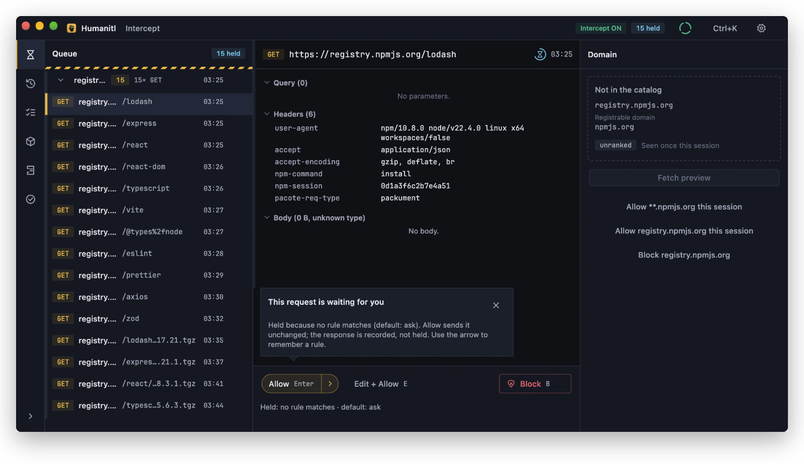
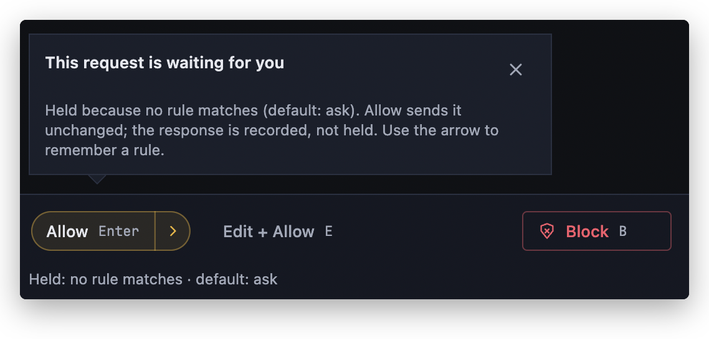
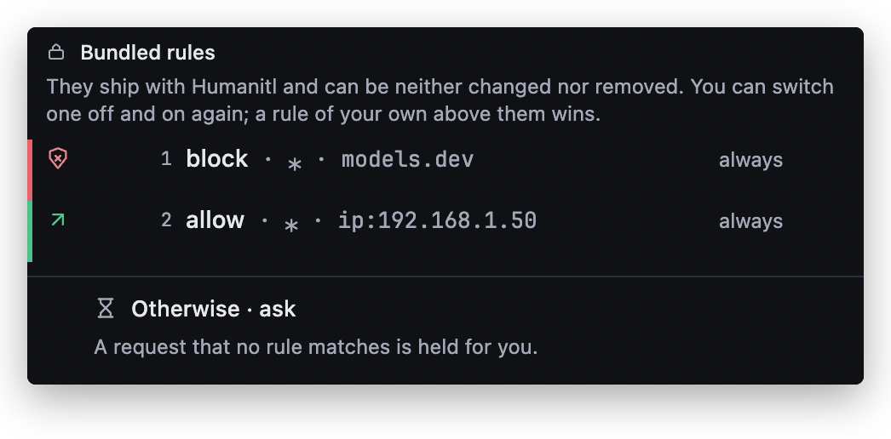
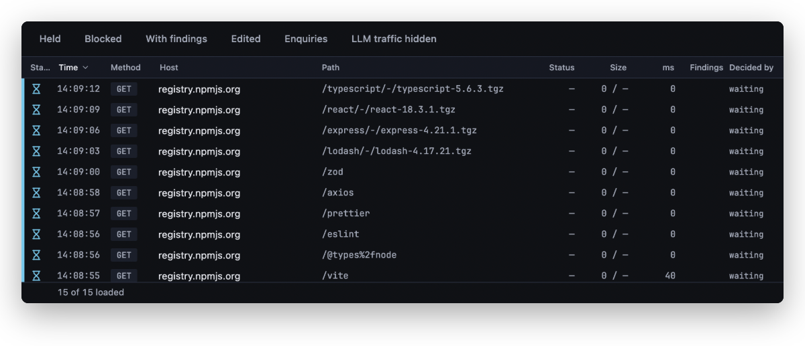
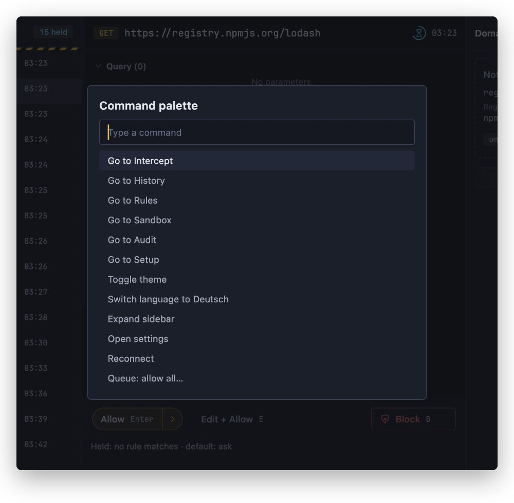

# Humanitl

<p align="center">
  
</p>

<p align="center"><strong>Humanitl lets a sandboxed AI coding agent use the internet, one approved request at a time.</strong></p>

<p align="center">
  <a href="https://github.com/nurkert/Humanitl/actions/workflows/ci.yml"></a>
  <a href="https://github.com/nurkert/Humanitl/releases"></a>
  <a href="LICENSE"></a>
  
</p>

<p align="center">
  <a href="https://humanitl.de/en/">Website</a> ·
  <a href="https://humanitl.de/en/download/">Download</a> ·
  <a href="docs/README.md">Documentation</a> ·
  <a href="docs/SECURITY.md">Security model</a> ·
  <a href="README.de.md">Deutsch</a>
</p>

<picture>
  <source media="(prefers-color-scheme: light)" srcset="images/readme/intercept-light.png">
  
</picture>

<p align="center"><sub>The macOS app replaying a recorded <code>npm install</code> in the daemon's demo mode: 15 requests held, none sent.</sub></p>

The agent runs in a sandbox that has no network interface (on macOS: interfaces exist, but every
way out except the door is refused, see [macOS](docs/SECURITY.md#12-macos-seatbelt-instead-of-bubblewrap)).
Its only way out is a moderating proxy on the host. A request that no rule decides is held, shown to
you with headers, parameters and body, and the proxy forwards it upstream only after you allow it.
Two kinds of traffic go without a hold: requests an `allow` rule matches, and the declared
passthrough to your language model. Everything is recorded, except during a recording outage (disk
full, database locked): then traffic continues unrecorded and the app says so on every card.

### In three steps

1. **The agent runs sealed.** bubblewrap and seccomp on Linux, Seatbelt on macOS; its only way out
   is the Humanitl proxy.
2. **Every unknown request is held.** You see method, host, headers, query and body, why it was
   held, and what the domain is.
3. **You decide.** Allow, edit and allow, block, or keep the decision as a rule; every decision is
   recorded in a hash-chained audit log.

Install: [Linux](#linux) · [macOS](#macos).

## Why

Local language models are now good enough for real work, but they know less by heart and need to
look things up. An agent working on sensitive client data can put that data into a request, through
prompt injection, a malicious package or a manipulated model. Until now the only safe answer was no
internet at all.

Humanitl makes internet access possible under human control: the agent asks, the proxy holds, a
person decides, and everything is recorded. Humanitl runs locally on your machine and sends no data
to us: no account, no telemetry, no crash reports.

## The three guarantees

The security argument fits in three sentences, and each one can be checked from inside the running
sandbox (`BACKLOG.md` 4.1).

### On Linux: bubblewrap and seccomp

1. **No network interface. There is nowhere for traffic to go.** `bwrap --unshare-all`: only `lo`
   exists, no outside address, no route, no DNS, no ICMP, no QUIC, no raw sockets.

   ```sh
   ip link        # shows only lo
   ```

2. **Exactly one door: a socket that leads to Humanitl.** The daemon's proxy socket is bound into
   the sandbox as a single file.

   ```sh
   find / \( -path /proc -o -path /sys -o \( -path '/dev/*' ! -path /dev/shm ! -path '/dev/shm/*' \) \) -prune -o -xtype s -print 2>/dev/null
   # exactly one line: /run/humanitl/proxy.sock
   ```

   `-xtype s`, not `-type s`: bwrap binds the proxy socket over an empty regular file, and `find` trusts the directory entry for a bare `-type`; and no `-xdev`, because `/work`, `/tmp`, `/dev/shm` and `/home/agent` are separate mounts where a planted socket must show up.

3. **The kernel opens no new door (seccomp).** The shim installs a filter before it starts the
   agent: `socket()` only for `AF_INET`/`AF_INET6` with `SOCK_STREAM`, everything else `EPERM`,
   plus `ptrace`, `io_uring_*`, `process_vm_*`, `keyctl` and every x32 syscall refused.

   ```sh
   grep Seccomp /proc/self/status   # Seccomp: 2
   ```

### On macOS: Seatbelt

macOS has no network namespace, no mount namespace and no seccomp. There the sandbox is Seatbelt:
the daemon writes one profile per session, and the kernel holds the shim and every process it
starts to that profile.

| # | Linux | macOS |
|---|---|---|
| 1 | No network interface | **No way out.** The interfaces exist, but every `connect`, `bind` and `sendto` except the door ends in `EPERM`; there is no name resolution. |
| 2 | Exactly one door | **Exactly one door.** Allowed are the daemon's proxy socket and the session's loopback port on which the shim relays to it. |
| 3 | seccomp | **The kernel holds the process to the profile.** `AF_ROUTE`, `AF_SYSTEM`, `AF_NDRV` and raw sockets are refused at `socket(2)`. |

The checks carry the Linux names, so the isolation panel and `humanitl sandbox check` read the same
report on both systems. What macOS gives less than Linux is listed under
[Where macOS gives less than Linux](#where-macos-gives-less-than-linux) and in
[`docs/SECURITY.md` section 12](docs/SECURITY.md#12-macos-seatbelt-instead-of-bubblewrap).

### Check it yourself

`humanitl sandbox check` runs all three in a short-lived sandbox, and the app shows them on the
Sandbox screen under Isolation, each with the evidence it produced:

```sh
humanitl sandbox check                                            # Linux
/Applications/Humanitl.app/Contents/MacOS/bin/humanitl sandbox check   # macOS
```

The shim measures the same three at every session start. If one fails, the session is stopped and
its state is `failed`; there is no "start anyway". The full argument is in
[`docs/SECURITY.md`](docs/SECURITY.md).

### What CI checks on every commit

The escape tests in [`tests/escape/`](tests/escape/) run in the CI job `escape-tests` on every
issue branch and on `main` ([`docs/SECURITY.md` section 9](docs/SECURITY.md#9-what-we-verify-in-ci)):

| Test | What it proves |
|---|---|
| ESC-1 [`sockets`](tests/escape/esc-1-sockets.sh) | socket families and types, `io_uring`, x32, interfaces, routing, capabilities, `Seccomp: 2` for every process, PID 1, refusals reported |
| ESC-2 [`mounts`](tests/escape/esc-2-mounts.sh) | mount surface, exactly one socket, no host `/proc`, hostname |
| ESC-3 [`egress`](tests/escape/esc-3-egress.sh) | no egress without the proxy; every request no rule decides lands in the queue (`allow` rules and the LLM passthrough skip it); no DNS before the decision, proven at the log of a recording name server |
| ESC-4 [`rules`](tests/escape/esc-4-rules.sh) | the rule table including homograph, IP literal, WebSocket and body cap |
| ESC-5 [`filesystem`](tests/escape/esc-5-filesystem.sh) | symlink marking, masked paths, OSC 52, audit tampering |
| Seatbelt suite [`macos/run.sh`](tests/escape/macos/run.sh) | in the CI job `macos`: every way out the profile must refuse, tried from inside a real Seatbelt sandbox (TCP, TLS, DNS, UDP, IPv6, raw and routing sockets, another loopback port, the home directory, masked files, the profile itself) |

## What it does not protect against

Read [`docs/THREAT-MODEL.md`](docs/THREAT-MODEL.md) before relying on Humanitl.

### Five declared side channels

Five side channels are declared, shown in the app and not closed. Two of them are open data paths
out of the sandbox:

| Channel | Data can leave? | What it means |
|---|---|---|
| [The LLM passthrough](docs/SECURITY.md#51-the-llm-passthrough) | yes | Your language model sees every prompt the agent sends it, without a hold; that host is part of what you trust. |
| [The project directory `/work`](docs/SECURITY.md#52-the-project-directory-work) | yes | It is writable; what the agent leaves there, a human may carry out later. |
| [Terminal output](docs/SECURITY.md#5-declared-side-channels) | no | It comes from the agent and is filtered, not trusted. |
| [Host names in the recording](docs/SECURITY.md#5-declared-side-channels) | no | They stand in plain text in the recording and in every export. |
| [Package caches](docs/SECURITY.md#5-declared-side-channels) | no | They are per project and carry data between sessions of that project. |

**Finally, you are the classifier:** an approved request goes out, so read what you approve
([`docs/SECURITY.md`](docs/SECURITY.md#5-declared-side-channels)). Responses and WebSocket frames
are recorded but not held, there is no HTTP/2 to the destination, and the isolation check runs
once the agent has started, not before; the full list is in
[section 5.6](docs/SECURITY.md#56-other-known-limits).

### Where macOS gives less than Linux

Each point is a channel in the threat model
([`docs/SECURITY.md`](docs/SECURITY.md#what-is-different-and-what-follows)):

- **Loopback is shared with the host (K-19).** The door listens on a loopback port that every
  local process of every account can reach. Such a process reaches only the proxy, but with the
  session's rules: what an `allow` rule or the LLM passthrough lets through goes out without a
  hold. The agent in turn reaches no other loopback port.
- **There is no PID namespace (K-20).** At the end of a session the shim kills the processes of
  its session, best effort. A process that starts another session outlives the sandbox and, while
  the daemon runs, can still send requests through the proxy socket under the profile. Until
  HUM-331 restricts that socket, restart the daemon (`humanitl daemon restart`) after a session
  you do not trust.
- **A deny list instead of an allow list for reading (K-21).** The sandbox reads everything outside
  `/Users`, `/Volumes`, `/private/var/folders` and `/private/tmp`, among them all of `/etc`,
  `/opt/homebrew` and `/usr/local/etc`. A credential in a configuration file there is readable by
  the agent, which could send it to the LLM passthrough without a hold. Keep secrets in your home
  directory.
- **Seatbelt is deprecated and documented only by example (K-22).** The macOS suite runs on the
  macOS 15 runners of GitHub and was run on macOS 27 during development; other versions are not
  tested. On every version a red isolation line stops the session.
- **Side channels inside the host (K-23):** POSIX semaphores and shared memory, the system log.
  None of them leaves the machine.

### Out of scope

Humanitl does not claim to protect against: an attacker with root on the host or a kernel
exploit; physical access; manipulated Humanitl packages; the human who approves; the LLM host;
what the agent writes into `/work` and a human later passes on; microarchitectural and timing
side channels; availability (a blocked agent is the intended outcome); other processes of the same
account; network attacks on the host itself
([`docs/SECURITY.md`](docs/SECURITY.md#out-of-scope)).

## Install

Every release is on the [releases page](https://github.com/nurkert/Humanitl/releases) and on
[humanitl.de](https://humanitl.de/en/download/), for Linux x86_64 and for macOS.

### Linux

Debian 13 or Ubuntu 24.04 and newer on x86_64, kernel 5.4 or newer, unprivileged user namespaces,
`bubblewrap` 0.8 or newer and a systemd user session. After installing, `humanitl doctor` prints
one line per precondition, with the fix for every line that is not ok.

#### APT repository (recommended)

```sh
curl -fsSL https://apt.nurkert.de/install/humanitl | sudo sh
humanitl daemon install        # runs: systemctl --user enable --now humanitld.socket
humanitl sandbox check
```

<details>
<summary>Read the script before running it</summary>

```sh
curl -fsSL https://apt.nurkert.de/install/humanitl | less
```

The script places the signing key of the repository at
`/usr/share/keyrings/nurkert-archive-keyring.gpg`, the source at
`/etc/apt/sources.list.d/nurkert.list`, and installs the package. Whoever does not trust a pipe
into a root shell takes the `.deb` from the release page instead
([`docs/INSTALL.md`](docs/INSTALL.md#apt-repository)).

</details>

| Format | File | Notes |
|---|---|---|
| APT repository | `apt.nurkert.de` | later versions arrive with `apt upgrade` |
| Debian package | `humanitl_<version>_amd64.deb` | `sudo apt install ./humanitl_<version>_amd64.deb`, then `humanitl daemon install`; the user service is socket-activated |
| Archive | `humanitl-<version>-linux-x86_64.tar.gz` | `bin/humanitl daemon install` writes its own user unit, without socket activation; for servers and scripted setups |

### macOS

`Humanitl-<version>-macos.dmg` (or the same app as `.zip`), for Apple Silicon and Intel, macOS 12
or newer. Open the disk image and drag Humanitl into Applications.

The app is signed ad hoc, not with an Apple Developer ID, so macOS refuses the first start. Allow
it once under System Settings › Privacy & Security › Open Anyway. The alternative in a terminal is
`xattr -dr com.apple.quarantine /Applications/Humanitl.app`; be aware that this removes the
Gatekeeper check for this app entirely, so run it only on a copy you downloaded from the release
page and verified. Start the app from Applications; the setup screen installs the daemon as a
launchd agent. The command line lies inside the app:

```sh
/Applications/Humanitl.app/Contents/MacOS/bin/humanitl daemon status
/Applications/Humanitl.app/Contents/MacOS/bin/humanitl sandbox check
```

### Verify the download

```sh
sha256sum -c SHA256SUMS --ignore-missing               # Linux
shasum -a 256 -c SHA256SUMS --ignore-missing           # macOS
```

Releases before 1.0.0 are **not signed**: `SHA256SUMS` protects against a damaged download, not
against a tampered release. Signed packages come with 1.0.0.

Prerequisites in detail, the agent, updates and removal:
[`docs/guides/install.md`](docs/guides/install.md).

## First session

1. Open the app; the setup screen checks the background service, the sandbox and the model server.
2. Enter your model server and test it ("Contact it").
3. Choose the project folder the agent may see.
4. Start the session and read the isolation check: three green lines and one amber line for the
   model.
5. Decide the first held request: allow, block, or remember it as a rule.

Step by step: [`docs/guides/first-session.md`](docs/guides/first-session.md).

### A tour of the app

The screenshots below come from the macOS app replaying a recorded `npm install` in the daemon's
demo mode.

#### Intercept



Held requests wait in a queue. `Enter` allows, `E` opens the editor, `B` blocks, and the arrow
next to Allow decides once, or remembers the decision as a rule for the session, an hour or for
good. Every card says why it was held, and the domain panel (on the right in the screenshot at the
top) shows the catalog entry, the registrable domain and its rank.

#### Edit before it leaves

The editor shows "As sent" and "Going out" side by side, with findings marked: card numbers,
e-mail addresses, IBANs, IPv4 addresses, phone numbers, secrets and terms of your own. "Replace all
with pseudonyms" swaps each finding for a stable placeholder. The target cannot be changed, and the
history keeps both versions.

#### Rules



A rule says `allow`, `block` or `ask` for a host pattern, narrowed by method, path, scheme or port. The order of evaluation is on the
screen: temporary rules, saved rules, bundled rules, then "Otherwise · ask"; the passthrough to your
model is checked before all of them. While you type, a dry
run shows which recent requests a rule would have matched; `humanitl rules test <url>` does the
same for one URL. Bundled rules can be switched off, not deleted.

#### History and audit



Every request of this and earlier sessions, filterable with `host:`, `decision:` and `since:`;
traffic to the model server is hidden by default. Export writes hosts, full paths, all headers and
both bodies in clear text, and says so before it writes. The audit log is an HMAC-sealed hash chain
with anchors: "Check now" verifies it, and it exports as JSONL or CSV. What the chain does not
prove is in [`docs/SECURITY.md` section 8](docs/SECURITY.md#8-the-audit-log).

#### The sandbox, visible

The Sandbox screen holds the agent's terminal, marked as untrusted output. On Linux it lists every
path the agent sees: the project as `/work`, read-write or read-only, everything else read-only or
empty, and "Show the exact command" opens the complete sandbox command line. On macOS the table and
the command preview still show that Linux plan until HUM-330, not the Seatbelt profile that runs;
what the agent can read there is under
[Where macOS gives less than Linux](#where-macos-gives-less-than-linux) (K-21).
`humanitl sandbox exec` opens a further shell next to the agent, under the same limits.

#### Keyboard first



`Ctrl+1` to `Ctrl+6` switch between Intercept, History, Rules, Sandbox, Audit and Setup; `Ctrl+K`
opens the command palette, `Ctrl+,` the settings.

#### Also included

- `humanitl doctor` and the setup checklist: one line per precondition, each with its fix.
- Any OpenAI-compatible model server or Ollama, found with `humanitl llm discover` and tested with
  `humanitl llm test`, with several saved servers. The access key lives in the system keyring on
  Linux, otherwise in a `0600` file, never in the configuration. The passthrough is logged, never
  held.
- The agents OpenCode and pi, the profiles `default` and `llm-only`, and your own adapter
  ([`docs/guides/agent-profiles.md`](docs/guides/agent-profiles.md)).
- A session summary with the touched files and a secret scan over the diff
  (`humanitl sessions summary`).
- English and German interface, dark and light theme, an optional tray icon on Linux.

## CLI

Every capability is an RPC first ([ADR-0018](docs/adr/0018-rpc-parity.md)); the app and the command
line `humanitl` are thin clients of the same daemon and see the same queue, rules and history.
Every command takes `--json` for machine-readable output.

```sh
humanitl run --profile llm-only                            # a session that may reach only the model
humanitl rules test https://registry.npmjs.org/left-pad    # which rule decides; exit 10 block, 11 ask
humanitl audit verify                                      # check the hash chain with key and anchors
humanitl doctor                                            # one line per precondition, with a fix
humanitl sandbox check                                     # the three guarantees, measured in a sandbox
humanitl sessions summary <id>                             # what a sandbox run changed in the project
```

| Screen | Command |
|---|---|
| Intercept | `humanitl flows list`, `humanitl flows decide` |
| Rules | `humanitl rules list`, `add`, `update`, `remove`, `test` |
| History | `humanitl flows list`, `humanitl flows show` |
| Audit | `humanitl audit verify`, `humanitl audit export` |
| Sandbox | `humanitl run`, `humanitl sandbox attach`, `humanitl sandbox exec` |

Every RPC next to its command and screen: [`docs/reference/parity.md`](docs/reference/parity.md).

### Documentation

The index of the user and reference documentation:

| Topic | Document |
|---|---|
| Installation, updates, removal | [`docs/guides/install.md`](docs/guides/install.md) |
| Your first session | [`docs/guides/first-session.md`](docs/guides/first-session.md) |
| Agents and session profiles | [`docs/guides/agent-profiles.md`](docs/guides/agent-profiles.md) |
| Every command and flag | [`docs/reference/cli.md`](docs/reference/cli.md) |
| The rule language | [`docs/reference/rules.md`](docs/reference/rules.md) |
| Resource limits | [`docs/reference/limits.md`](docs/reference/limits.md) |
| Configuration keys | [`docs/CONFIG.md`](docs/CONFIG.md) |
| Diagnostic codes | [`docs/DIAGNOSTICS.md`](docs/DIAGNOSTICS.md) |
| Security argument | [`docs/SECURITY.md`](docs/SECURITY.md) |
| Threat model | [`docs/THREAT-MODEL.md`](docs/THREAT-MODEL.md) |
| Architecture | [`docs/ARCHITECTURE.md`](docs/ARCHITECTURE.md) |
| Decision records | [`docs/adr/README.md`](docs/adr/README.md) |
| Design system | [`docs/DESIGN.md`](docs/DESIGN.md) |
| All documentation | [`docs/README.md`](docs/README.md) |

## How it works

<picture>
  <source media="(prefers-color-scheme: light)" srcset="images/readme/architecture-light.png">
  
</picture>

<details>
<summary>Text diagram</summary>

```
+--------------------------------+      gRPC over UDS       +------------------------------------+
| Humanitl (Flutter)             | <----------------------> | humanitld (Rust)                   |
|  GTK on Linux, AppKit on macOS |  Stream: FlowEvent       |  systemd --user / launchd          |
|  Intercept · History · Rules   |  Cmds: Decide, Rules,    |  proxy     hold queue, MITM        |
|  Sandbox · Audit · Setup       |        Sandbox, Query    |  rules     pure matching logic     |
|  Terminal (xterm via stream)   |                          |  findings  regex detectors         |
+--------------------------------+                          |  recorder  SQLite + blobs          |
                                                            |  audit     hash chain              |
                                                            |  sandbox   backend trait           |
                                                            |  ipc       tonic server            |
                                                            +-----------------+------------------+
                                                                              | exactly one door
                                                            +-----------------v------------------+
                                                            | sandbox                            |
                                                            |  Linux: bwrap --unshare-all        |
                                                            |         + seccomp, socket bind     |
                                                            |  macOS: sandbox-exec, Seatbelt     |
                                                            |         profile, loopback door     |
                                                            |  shim: bridge, then exec agent     |
                                                            |  agent (OpenCode, pi) HTTP_PROXY=  |
                                                            |        127.0.0.1:3128 on Linux,    |
                                                            |        session port on macOS       |
                                                            |  /work  (project, ro|rw)           |
                                                            |  CA only as .crt, env kit set      |
                                                            +------------------------------------+
                                                                              |
                                                     LAN LLM (passthrough rule, logged)  ·  Internet (only after approval)
```

</details>

The daemon resolves a host name only after a request was allowed
([ADR-0006](docs/adr/0006-dns-after-allow.md)), so not even a DNS lookup leaves before you decide.
The proxy is an own accept loop on hyper 1 with tokio-rustls and rcgen
(`daemon/crates/proxy/src/core.rs`); layers, crates and the dependency rules CI enforces are in
[`docs/ARCHITECTURE.md`](docs/ARCHITECTURE.md), the decisions in
[`docs/adr/`](docs/adr/README.md). The isolation model follows the Linux sandboxes of Claude Code
and the OpenAI Codex CLI, with [bubblewrap](https://github.com/containers/bubblewrap) as the
sandbox; on macOS it is Seatbelt ([ADR-0019](docs/adr/0019-seatbelt-on-macos.md)).

## Status

| Milestone | Delivers | Status |
|---|---|---|
| M0 Foundation | monorepo, CI, protobuf contract, core types, fake daemon, escape-test harness | delivered |
| M1 Sealed box | sandbox provably closed, proxy holds a request | delivered |
| M2 First decision | rules, findings, recorder, intercept and history screens | delivered |
| M3 Agent inside | OpenCode against a LAN model, terminal, isolation check, `humanitl run` | delivered |
| M4 Trusted editor | pseudonymisation, audit chain, settings, German and English, packages | delivered |
| M5 Release 0.1 | fuzzing, limits, error paths, documentation, release | in progress |
| M12 macOS | Seatbelt sandbox, launchd agent and a disk image in every release | in progress |

A milestone counts as delivered when its demo script runs green in CI against a real daemon and a
real sandbox (`tests/e2e/`), not when its code exists.

Version 0.1.0 is the first release (milestone M5). In it: the sealed sandbox with the three
guarantees and five escape tests in CI; the intercept queue with allow, block, edit and rules; the
OpenCode and pi agents against a model in your network, with terminal and isolation check; history,
export and a hash-chained audit log; pseudonymisation in the editor; settings, German and English;
a `.deb` and a tarball. Since then: macOS with a Seatbelt sandbox, a launchd agent and a disk image
in every release (M12). Not in it: holding responses or WebSocket frames, HTTP/2 to the
destination, a Docker or micro-VM backend, a browser for the agent. What comes after the MVP is
listed in [`BACKLOG.md` section 9](BACKLOG.md#9-nach-dem-mvp-priorisiert).

### Project health

- CI on every commit to `main`, every issue branch and every pull request
  ([`ci.yml`](.github/workflows/ci.yml)): Rust, Flutter, golden
  tests, the escape tests on Linux and macOS, and end-to-end runs against a real daemon.
- Nightly fuzzing of the parsers and decoders ([`fuzz-nightly.yml`](.github/workflows/fuzz-nightly.yml)).
- Every release carries `SHA256SUMS`; see the [releases page](https://github.com/nurkert/Humanitl/releases).
- Generated reference pages (CLI, configuration, diagnostics, parity) are checked for staleness in
  CI.

## Contributing

Read [`CONTRIBUTING.md`](CONTRIBUTING.md) for toolchain, workflow and the definition of done. The
plan lives in [`BACKLOG.md`](BACKLOG.md) and the issue specifications in [`backlog/`](backlog/);
names and types every part agrees on are in [`backlog/CONVENTIONS.md`](backlog/CONVENTIONS.md).
Code and the user documentation are in English; the backlog, code comments and some reference
pages are in German. The most useful contribution is still to read
[`docs/SECURITY.md`](docs/SECURITY.md) and tell us where the reasoning is wrong. Security problems
go through [`SECURITY.md`](SECURITY.md), not public issues.

## License

GPL-3.0-only. See [`LICENSE`](LICENSE). Domain data from the
[Public Suffix List](https://publicsuffix.org/) and the
[Majestic Million](https://majestic.com/reports/majestic-million) under CC BY 3.0
(`catalog/RANKS-LICENSE`). The app icon is based on Font Awesome Free (CC BY 4.0); see
[`THIRD_PARTY.md`](THIRD_PARTY.md).
