# Design

Applies to: Humanitl 0.1

This is the design system of the Humanitl desktop app: the direction, the
tokens, the widget vocabulary and the few rules that hold it together. It is
written for contributors who touch `app/`.

Two other documents cover neighbouring ground and are not repeated here:

- [docs/UX.md](UX.md) (German) describes how motion, colour, text and keyboard
  work together screen by screen, with the reasoning behind every rule. Where
  this page states a value, UX.md states how to use it.
- [docs/GLOSSARY.md](GLOSSARY.md) (German) is the binding list of UI terms in
  English and German.

The values live in code, in [`app/packages/ui`](../app/packages/ui). When this
page and the code disagree, the code wins and this page is out of date. The
token tables below are the output of
[`app/packages/ui/tool/dump_tokens.dart`](../app/packages/ui/tool/dump_tokens.dart);
regenerate them instead of editing them by hand:

```sh
cd app/packages/ui && flutter test tool/dump_tokens.dart
```

The script prints the tables between the markers `BEGIN TOKENS` and
`END TOKENS`. Flutter then reports "No tests ran" and exits with code 79; that
is expected, the script has no test cases.

The screenshots on this page are copies of the golden images in
`app/test/goldens/goldens/ci/`. The golden harness renders every glyph of text
as a solid block (the Ahem test font), so the images show geometry, colour and
state, not wording.

## Contents

- [Direction "Airlock"](#direction-airlock)
- [Tokens](#tokens)
- [Components](#components)
- [Layout](#layout)
- [Interaction](#interaction)
- [Motion](#motion)
- [Signature elements](#signature-elements)
- [Language](#language)
- [Anti-patterns](#anti-patterns)

## Direction "Airlock"

### Mood

A calm control room. Every request the agent makes is a package in an airlock:
the interface makes waiting safe and the decision obvious. The surface is
dense, monochrome and precise. Colour appears only when a state changes, and
then it means that state and nothing else.

### References

| Product | What we take from it |
|---|---|
| Linear | A tinted neutral surface, 13 px density, keyboard first |
| Raycast | The command palette as the primary way to act |
| Zed | Hairlines instead of shadows, a quiet status bar |
| Little Snitch | Allow or deny, times duration, times target, with a countdown |

### Anti-references

| Pattern | Why not |
|---|---|
| Burp and ZAP | Visual noise: every panel shouts, nothing is the one important thing |
| Neon | Colour as decoration competes with colour as state |
| Terminal green | Green means "allowed" here; it cannot also be the ambient colour |
| Modal dialogs for decisions | A decision happens in the queue; a modal is reserved for destructive confirmations |

## Tokens

All tokens are reached through `HTokens`, published by `HTheme` and read with
`HTheme.of(context)`. There is a dark and a light instance; the dark theme is
the one the design is drawn for. Scales (type, spacing, radius, sizes, motion)
are shared by both themes. The constants behind them are `HColors`, `HType`,
`HSpace`, `HRadius`, `HSize` and `HMotion` in
[`app/packages/ui/lib/src/tokens/`](../app/packages/ui/lib/src/tokens).

### Colour rules

- Dark first, with cool tinted neutrals (hue around 230).
- One accent, the brand yellow `#E8B84B`; in the light theme the ochre
  `#A57A1C`. Text and glyphs on the accent are dark, `#14161C`, in both
  themes. The accent marks focus, the primary button, selection and links,
  and nothing else. Before HUM-260 the accent was the blue `#7C9CF5`, which is
  now the `info` colour.
- State colours mean states. Red means blocked and nothing else, which is why
  error and secret findings are orange.
- Tints are at most 10 percent alpha (`HColors.tintAlpha`).
- Every colour has an area variant and a text variant. Areas (rails, arcs,
  glyphs, fills) must reach 3:1 against every surface; words must reach 4.5:1,
  including on their own tint. The text variants are derived at runtime by
  `HColorDerivation.textVariant`, never written by hand.
- The light state colours are derived from the dark ones by
  `HColorDerivation.lightState`: 12 percent lower HSL lightness, then lowered
  further in 1 percent steps until the colour reaches 3:1 on all four light
  surfaces.
- Colour is never the only channel. Every state also has a glyph (see
  [`HStateGlyph`](#hstateglyph)), because in the light theme `allowed` and
  `blocked` measure 1.01:1 under deuteranopia.

The rules behind these numbers, and the list of surfaces each colour is
measured against, are in [docs/UX.md, section 3.3](UX.md#33-colour-means-state)
and [section 6](UX.md#6-accessibility-as-numbers).

### Surfaces, text and accent

| Token | Dark | Light |
|---|---|---|
| `bg0` | `#0F1115` | `#FAFBFD` |
| `bg1` | `#151821` | `#FFFFFF` |
| `bg2` | `#1B1F2A` | `#F3F5F9` |
| `bg3` | `#232838` | `#E9ECF3` |
| `line` | `#2A3040` | `#E1E5EE` |
| `lineStrong` | `#384056` | `#C9CFDC` |
| `fg0` | `#E6E8EE` | `#16181F` |
| `fg1` | `#A3A9B8` | `#4B5162` |
| `fg2` | `#6B7186` | `#7C8294` |
| `accent` | `#E8B84B` | `#A57A1C` |
| `accentText` | `#E8B84B` | `#755714` |
| `accentFill` | `#E8B84B` | `#A57A1C` |
| `onAccent` | `#14161C` | `#14161C` |
| `warning` | `#E8B84B` | `#A57A1C` |
| `warningText` | `#E8B84B` | `#755714` |
| `info` | `#7C9CF5` | `#5B7FE6` |
| `infoText` | `#8FAAF6` | `#204FD4` |

What the surfaces are for: `bg0` is the application background, `bg1` a
panel, `bg2` a raised surface inside a panel (rows, inputs, hover), `bg3` the
highest surface (selection, pressed). `fg0` is primary text, `fg1` secondary,
`fg2` tertiary and truly disabled. `warning` has the value of the accent on
purpose (yellow means caution, as on barrier tape), so a warning always comes
with a glyph or a word, never as colour alone.

### State colours

| State | Dark area | Dark text | Light area | Light text |
|---|---|---|---|---|
| `held` | `#79C9EC` | `#79C9EC` | `#1C91C5` | `#136386` |
| `allowed` | `#4FBF8C` | `#56C291` | `#36956A` | `#26684A` |
| `allowedEdited` | `#57B99F` | `#62BEA5` | `#3E957E` | `#2B6656` |
| `blocked` | `#E5646E` | `#EB878F` | `#DC303D` | `#A81C27` |
| `timedOut` | `#8A90A2` | `#A4A8B6` | `#6A7185` | `#565B6B` |
| `autoRule` | `#994FBF8C` | `#99ECF8F3` | `#991C4E38` | `#99020705` |
| `passthroughLlm` | `#B48AF0` | `#C09CF2` | `#9154E9` | `#7122E3` |
| `error` | `#F0784F` | `#F28E6B` | `#EB4D17` | `#A2340E` |

Eight-digit values are `#AARRGGBB`: `autoRule` is `allowed` at 60 percent
alpha. `held` is a cool sky cyan since HUM-260; before that it was the amber
`#E0B24A`, which would now collide with the yellow accent. `allowedEdited` is
its own teal green and carries an accent pencil dot in its glyph.

Each row of the image below shows, from left to right: the state rail, the
glyph, the label in the text colour, the area swatch, the 10 percent tint and
the text swatch.

| Dark | Light |
|---|---|
| 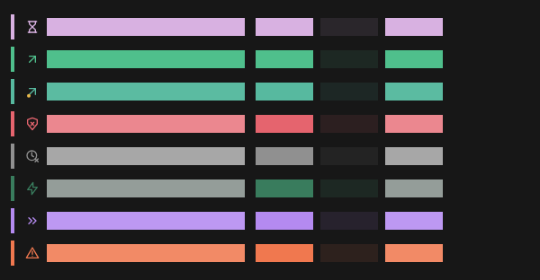 | 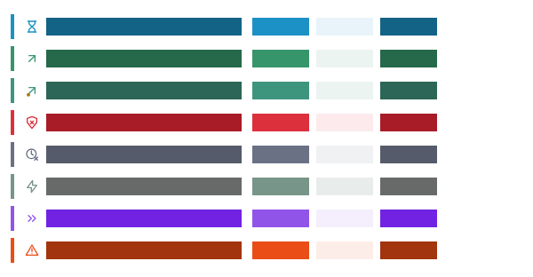 |

### Method colours

HTTP methods borrow hues but are never states: a `DELETE` is not a block.

| Method | Dark area | Dark text | Light area | Light text |
|---|---|---|---|---|
| GET, HEAD | `#E8B84B` | `#E8B84B` | `#A57A1C` | `#755714` |
| POST | `#B48AF0` | `#C09CF2` | `#9154E9` | `#7122E3` |
| PUT, PATCH | `#79C9EC` | `#79C9EC` | `#1C91C5` | `#136386` |
| DELETE | `#B3E5646E` | `#B3F6C8CC` | `#B3D42431` | `#B3560F14` |
| other | `#6B7186` | `#9CA1B0` | `#7C8294` | `#585D6C` |

`DELETE` is the blocked hue at 70 percent alpha. In a list the method badge
stands neutral on `bg2` (`HMethodBadge(neutral: true)`), so that a reddish
badge next to a red rail does not read as two blocks.

### Terminal palette

The sandbox terminal maps the 16 ANSI colours onto the same ladder
(`HTerminalPalette`, HUM-042).

| Slot | Dark | Light |
|---|---|---|
| background | `#0F1115` | `#FAFBFD` |
| foreground | `#E6E8EE` | `#16181F` |
| cursor | `#E8B84B` | `#A57A1C` |
| selection | `#1AE8B84B` | `#1AA57A1C` |
| black | `#1B1F2A` | `#C9CFDC` |
| red | `#E5646E` | `#DC303D` |
| green | `#4FBF8C` | `#36956A` |
| yellow | `#E8B84B` | `#A57A1C` |
| blue | `#6F8FEF` | `#3864E9` |
| magenta | `#B48AF0` | `#9154E9` |
| cyan | `#79C9EC` | `#1C91C5` |
| white | `#A3A9B8` | `#4B5162` |
| bright black | `#6B7186` | `#7C8294` |
| bright red | `#EC9097` | `#BA1F2B` |
| bright green | `#74CDA4` | `#28704F` |
| bright yellow | `#EECA78` | `#795A15` |
| bright blue | `#9DB3F4` | `#1847D6` |
| bright magenta | `#D1B7F6` | `#7427E3` |
| bright cyan | `#A6DBF2` | `#167098` |
| bright white | `#E6E8EE` | `#16181F` |

### Typography

Two families. Inter for the UI, with tabular figures (`tnum`) and the
single-storey `cv11`. JetBrains Mono for URLs, headers, bodies, hashes, rules
and method badges, with ligatures off and tabular figures. The font files are
not bundled; each family has a fallback stack (`HType.uiFallback`,
`HType.monoFallback`).

| Token | Family | Size/line (px) | Weight |
|---|---|---|---|
| `ui11` | Inter | 11/16 | 400 |
| `ui12` | Inter | 12/16 | 400 |
| `ui13` | Inter | 13/20 | 400 |
| `ui14` | Inter | 14/22 | 400 |
| `ui16` | Inter | 16/24 | 400 |
| `ui20` | Inter | 20/28 | 400 |
| `mono11` | JetBrains Mono | 11/16 | 400 |
| `mono12` | JetBrains Mono | 12/16 | 400 |
| `mono13` | JetBrains Mono | 13/20 | 400 |
| `mono14` | JetBrains Mono | 14/22 | 400 |

Weights are 400, 500 (`.medium`) and 600 (`.semibold`). There is no 700.
Line length is capped at 90 monospace characters (`HSize.measureChars`); spare
pane width becomes gutter, never line length.

### Spacing

Everything is a multiple of the 4 px base unit.

| Token | px |
|---|---|
| `unit` | 4 |
| `x1` | 4 |
| `x2` | 8 |
| `x3` | 12 |
| `x4` | 16 |
| `x5` | 20 |
| `x6` | 24 |
| `x7` | 28 |
| `x8` | 32 |
| `panelPadding` | 12 |

### Radius

| Token | px | Used for |
|---|---|---|
| `control` | 4 | Buttons, pills, inputs |
| `card` | 6 | Cards, modals, sheets |
| `panel` | 0 | Panels: square |
| `badge` | 2 | Badges |

### Sizes

| Token | Value (px) |
|---|---|
| `headerBar` | 40 |
| `statusBar` | 24 |
| `paneHeaderHeight` | 48 |
| `railItemHeight` | 48 |
| `borderWidth` | 1 |
| `row` | 36 |
| `rowSelected` | 56 |
| `rowHistory` | 28 |
| `rowBody` | 24 |
| `rowActionSlot` | 28 |
| `hitMin` | 28 |
| `hitDecision` | 120 x 32 |
| `paneMinQueue` | 280 |
| `paneMinInspector` | 480 |
| `paneMinContext` | 260 |
| `paneRatio` | 28/44/28 (percent) |
| `measureChars` | 90 (characters) |
| `stateRail` | 4 |
| `selectionRail` | 2 |
| `cautionTape` | 4 |
| `hairline` | 1 |
| `splitter` | 7 |
| `glyph` | 16 |
| `tick` | 14 |
| `ringStroke` | 1.5 |

Row heights are minimum heights, not fixed heights: at a text scale of 2.0 a
row grows with its text. `rowSelected` (56) is now the two-line detail row of
History; a queue row stays 36 px in every state.

### Motion tokens

| Token | Value |
|---|---|
| `enter` | cubic-bezier(0.2, 0.0, 0.0, 1.0) |
| `exit` | cubic-bezier(0.4, 0.0, 1.0, 1.0) |
| `arrive` | 180 ms |
| `press` | 120 ms |
| `sweep` | 200 ms |
| `leave` | 220 ms |
| `ruleDraw` | 240 ms |
| `breathe` | 1200 ms |
| `holdToConfirm` | 400 ms |
| `holdToBlock` | 250 ms |
| `stagger` | 30 ms |
| `rearm` | 350 ms |
| `checkStagger` | 120 ms |
| `cautionTape` | 1200 ms |
| `arriveOffset` | 8 px |
| `leaveOffset` | 12 px |
| `breatheBelow` | 0.2 |
| `breatheMinOpacity` | 0.72 |

How these combine into the visible micro-interactions is described under
[Motion](#motion).

## Components

A screen builds its look only from the `H*` widgets of `app/packages/ui`.
Behind them stands `shadcn_flutter`, pinned exactly; only this package may
import it (`tools/check-deps.sh` enforces that). `HTheme` builds the library's
theme from `HTokens`, so there is one palette, not two. The developer gallery
`HGalleryPage` shows every token and widget in both themes.

Every interactive widget is a focus stop, at least `hitMin` (28 px) tall, and
shows focus with `HFocusRing`. Interaction states that a golden test cannot
produce with a pointer can be forced with a `preview` argument (gallery and
tests only).

### HButton

Four roles, no fifth (`HButtonVariant`):

| Variant | Look | Use |
|---|---|---|
| `primary` | Filled with `accentFill`, text in `onAccent` | The one action a surface wants |
| `secondary` | Tinted surface with a hairline | A second, equal action |
| `ghost` | No surface until hovered | Quiet actions, the isolation ring |
| `danger` | The blocked hue | Destructive actions, including Block |

Sizes: `sm` is 28 px minimum height, `md` is 32 px. States: rest, hovered,
pressed, focused (ring outside the button, 2 px gap on the primary button),
disabled (`onPressed: null`). The pressed fill runs for `press` (120 ms) and
keeps its full duration under reduced motion.

### HIconButton

A glyph that is also a 28 px hit target, for close affordances and wherever a
label would be noise. Quiet role: no surface at rest, `bg2` under the pointer,
`bg3` when pressed, focus ring outside. Always has a `semanticsLabel`.

### HPill

The split pill behind the [Release Valve](#release-valve). Left half: the plain
action once; holding it for `holdToConfirm` (400 ms) fills and performs the
remembered variant. Right half: a chevron that opens the duration and target
grid. Both halves are separate focus stops; Enter or Space held does the same
as holding the pointer. States: rest (6 percent fill), hovered, pressed,
holding (fill grows to 20 percent), focused per half.

### HRow

One row of the queue, the rule list or History. Three densities: `row` (36),
`rowHistory` (28), `rowBody` (24), all minimum heights.

| State | Look |
|---|---|
| Rest | 4 px state rail on the left, glyph, title, trailing content |
| Hovered | `bg2` fill; the action slot on the right reveals its action |
| Selected | `bg3` fill; the accent replaces the state rail over the full 4 px |
| In selection | Accent rail without the cursor fill (multi-select) |
| Focused | Ring drawn on the row's own edge (`HFocusRing.inline`) |

Hover and selection never share a fill: Enter allows the selected row, and
allowing cannot be undone. The action slot is always reserved (28 px) and never
moves text.

| Held | Hovered | Selected |
|---|---|---|
| 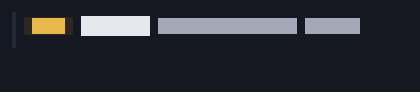 | 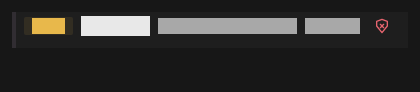 | 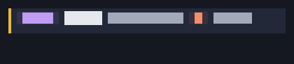 |

### HStateGlyph

The glyph of a flow state, 16 px, optionally inside a countdown ring
(`ringStroke` 1.5 px). Glyph per state: `held` hourglass, `allowed` arrow up
right, `allowedEdited` arrow with accent pencil, `blocked` shield with cross,
`timedOut` clock with cross, `autoRule` bolt, `passthroughLlm` double chevron,
`error` warning triangle. The ring shows the remaining hold budget as arc
length; used time is a gap, not a track. It never turns red. Below 20 percent
and again below 5 percent the glyph breathes three times, never below
72 percent opacity, then rests. Under reduced motion a second, still ring at
40 percent alpha replaces the breath.

### HGlyphIcon

Draws one `HGlyph` (17 shapes after the Lucide icons) at a size and colour. The
glyphs are painted, not loaded from an icon font.

### HBadge and HMethodBadge

`HBadge` is a small tinted label: 11/500, radius 2, 10 percent area tint, chip
18 px tall inside a reserved 28 px. Area colour and text colour are separate
(`color` and `textColor`); the text defaults to the text variant of the area
colour. With `onTap` it becomes a focus stop. `mono: true` uses the monospace
family for protocol tokens.

`HMethodBadge` is an uppercase monospace `HBadge` in the method hue, or
neutral on `bg2` in lists.

### HTextField

A one-line input on `bg2` with a hairline border and the accent as cursor.
Monospace by default, because most inputs are compared with something
(hosts, paths). States: empty with `fg2` placeholder, filled, focused (ring
drawn by the library with our metrics: 2 px accent, 2 px gap), disabled.
`onChanged` reports only what a person typed.

### HCheckbox

A box with its label and an optional `hint` sentence that says what ticking it
costs. Box 14 px (`tick`). States: off, on (accent fill, `onAccent` tick),
focused, disabled (everything in `fg2`, no accent).

### HSegmented and HChoiceChips

`HSegmented` is a row of mutually exclusive options; `HChoiceChips` is a row
of independent toggles. The chosen option gets the highest surface and primary
text, never the accent fill: the accent belongs to the one action of a screen.
Each segment is its own focus stop, at least 28 px tall. `HSegment` and
`HSegmentOption` are their building blocks.

### HPanel

A persistent region of the shell: `bg1`, hairline border, no radius, no
shadow. Optional title (13/600) with actions, a hairline below it, 12 px body
padding.

### HSheet

A panel that slides in from the right, 360 px wide by default: rule from
request, history detail, isolation details, settings. It never asks a question
that would block the queue. It holds the focus while open and closes on
Escape. Title 16/600, close affordance is an `HIconButton`.

### HModal

A centred card (420 px default) over a scrim. Reserved for destructive
confirmations: blocking more than five flows at once, deleting a forever rule,
stopping a running sandbox. Traps focus, returns it on close, Escape dismisses
when the modal is dismissible. Title 16/600, actions right-aligned.

### HPopover

A small box with an arrow that explains a control once (a coach mark). It sits
beside its target in the layout, never over it, takes no focus and binds no
key. It arrives with `arrive` and `arriveOffset`, without blinking. Arrow up or
down (`HPopoverArrow`).

### HContextMenu

The right-click menu (`HMenuItem`, `HContextMenuController`). It appears
without motion; every entry is at least 28 px tall and fills under the
pointer. Disabled entries stay in place so the order never changes.

### HHairline

A 1 px separator, horizontal or vertical, in `line` or `lineStrong`. The design
uses hairlines where others use shadows.

### HFocusRing

The one focus ring of the system: 2 px of accent outside the control, shown in
one frame, never animated, never recolouring an existing border. A 2 px gap
appears only where the ring would otherwise touch a fill of the same colour
(the primary button). `HFocusRing.inline` draws on the child's own edge for
edge-to-edge rows.

### HSkeleton and HWait

`HSkeleton` draws the hairlines of the rows that are about to arrive, in `fg2`,
without motion, at the height of the list it stands in. There is no spinner in
the app. `HWait` applies the two thresholds: nothing for the first 150 ms, then
the skeleton for at least 400 ms.

### HCautionTape

The barrier tape: diagonal stripes in brand yellow and black, 4 px tall, moving
sideways at one period (16 px) per 1200 ms. It is a brand mark, not a state and
not a control, and stands still under reduced motion. Where it may appear is
ruled in [docs/UX.md, section 3.6](UX.md#36-the-caution-tape).

### HAnimatedFill

Animates one colour with a duration that survives the platform's
`disableAnimations` flag. Used for press fills, which keep their full duration
under reduced motion.

### Editor decorations

`HDecoratedTextController`, `HEditorDecoration` and `HEditorDecorations` paint
the three editor marks: `secret` (wavy underline in `error`), `pii` (wavy
underline in `warning`) and `replaced`, the [Diff-Glow](#diff-glow).

### Theme plumbing

`HTheme` (with `HTheme.dark`, `HTheme.light`) publishes the tokens;
`HThemeMode` (`dark`, `light`, `system`) maps the `ui.theme` setting to them;
`hLocalizationsDelegates` supplies the library's own strings.

## Layout

The shell is a 40 px header bar, a left icon rail, the active section and a
24 px status bar. Panes are persistent and resizable; sheets come in from the
right; modals are only for destructive confirmations.

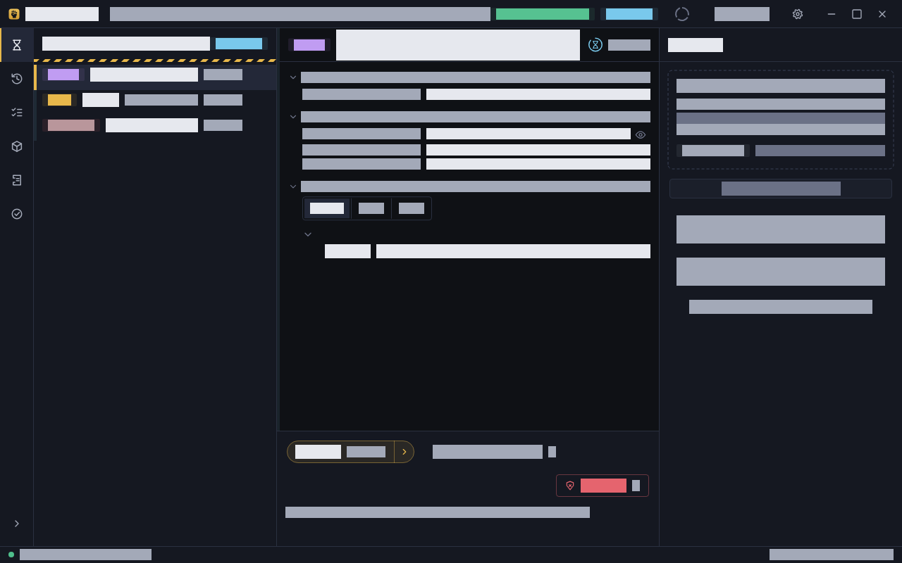

### Shell

| Part | Size | Notes |
|---|---|---|
| Header bar | 40 px | App mark, session, isolation ring, window controls |
| Icon rail | 48 px collapsed, 200 px expanded | Intercept, History, Rules, Sandbox, Audit, Setup; `Ctrl+0` toggles |
| Status bar | 24 px | Daemon connection, quiet text |
| Pane header | 48 px, border included | `paneHeaderHeight`, always `HPaneHeader`; the same row as the first rail item |
| Rail item | 48 px | `railItemHeight`; starts directly under the header bar |
| Active section marker | 2 px accent on the rail, full item height | `selectionRail` |

Every pane and side sheet header ends on one line across the window, and two
adjacent regions share one divider. The rules are in
[docs/UX.md, section 3.7](UX.md#37-layout-grid).

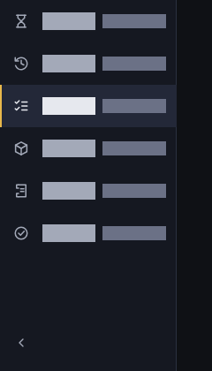

### Intercept: three panes

| Pane | Default share | Minimum width | Content |
|---|---|---|---|
| Queue | 28 % | 280 px | Held requests, grouped by host |
| Inspector | 44 % | 480 px | The request card, the action bar, or the editor |
| Context (domain) | 28 % | 260 px | What is known about the target domain |

Splitters are 7 px grips with a 1 px hairline in the middle, 2 px while
dragged, and move 8 px per arrow key when focused. The ratios persist in
`intercept.pane_ratios`.

### Queue row

36 px minimum height in every state, single line: 4 px state rail, 16 px state
glyph with its countdown ring, neutral method badge, host (13/500), path in
mono 12 shortened in the middle, findings chip, and the reserved 28 px action
slot, where hover or focus reveals Block (250 ms hold). The remaining time is
the arc of the ring, not `mm:ss` digits, and a row never allows; allowing
needs the full URL on the card. Hosts are never shortened at the end. The full
anatomy is in [docs/UX.md, section 3.4](UX.md#34-the-queue-row-written-out). A 4 px
caution tape runs under the queue header while at least one request is held.

### Other fixed widths

| Element | Width |
|---|---|
| `HSheet` default | 360 px |
| `HModal` default | 420 px |
| Decision hit target (Allow, Block) | at least 120 x 32 px |
| Smallest hit target | 28 px |

Screen-by-screen layout (History, Rules, Sandbox, Audit, Setup, empty states)
is in [docs/UX.md](UX.md).

## Interaction

The keyboard is a first-class way to work: every pointer path has a key
([docs/UX.md, section 5](UX.md#5-keyboard-and-mouse)). Single-letter keys never
fire while a text field has focus; the chords (`Ctrl+F`, `Ctrl+L`) do. The two
decision keys ignore key repeat, and Allow re-arms only 350 ms after a new
request is selected, so a held Enter cannot allow the queue unread.

### Shortcuts

The vocabulary is fixed in
[backlog/CONVENTIONS.md, section 3.9](../backlog/CONVENTIONS.md#39-flutter-app).
The table lists each binding as the app has it in 0.1, checked against
`app/lib/core/shortcuts/intents.dart`, `app/lib/features/intercept/intents.dart`,
`app/lib/features/history/history_screen.dart` and
`app/lib/features/editor/editor_intents.dart`.

| Key | Action | Intent | Where |
|---|---|---|---|
| `Enter`, `A`, `Ctrl+F` | Allow the selected request once, unchanged | `AllowIntent` | Intercept |
| `B`, `Ctrl+L` | Block the selected request | `BlockIntent` | Intercept |
| `Ctrl+Enter` | Block with the note, from inside the note field | `BlockIntent` | Intercept |
| `E` | Open the editor for the selected request | `EditIntent` | Intercept |
| `N` | Focus the block note | `NoteIntent` | Intercept |
| `Shift+Enter` | Open the remember grid without deciding | `OpenRememberIntent` | Intercept |
| `1` to `4` | Remember duration: once, session, one hour, always | `RememberDurationIntent` | Intercept |
| `Shift+1` to `Shift+4` | Remember target: exact URL, host, domain, host and method | `RememberTargetIntent` | Intercept |
| `Ctrl+Shift+F` | Allow the selection or the group under the cursor | `AllowGroupIntent` | Intercept |
| `Ctrl+Shift+L` | Block the selection or the group under the cursor | `BlockGroupIntent` | Intercept |
| `Ctrl+A` | Select the group under the cursor | `SelectGroupIntent` | Intercept |
| `Left`, `Right` | Fold or open the group | `ToggleGroupIntent` | Intercept |
| `Shift+J` | Merge requests that arrived while reading | `MergeArrivalsIntent` | Intercept |
| `J`, `Down` / `K`, `Up` | Next / previous row | `NextFlowIntent` / `PrevFlowIntent` | Intercept, History |
| `Esc` | Close the coach mark | `CloseCoachMarkIntent` | Intercept |
| `S` / `P` / `Esc` | Send anyway / pseudonymize / close, in the findings pause | `SendAnywayIntent` / `PseudonymizeIntent` / `CloseFindingsPauseIntent` | Findings pause |
| `Ctrl+R` | Pseudonymize the selection | `PseudonymizeSelectionIntent` | Editor |
| `Ctrl+Enter` | Send the edited version | `SendEditedIntent` | Editor |
| `F3` | Next finding | `NextFindingIntent` | Editor |
| `Esc` | Close the editor | `CloseEditorIntent` | Editor |
| `Enter` | Open the selected row | `OpenFlowIntent` | History |
| `/` | Focus the filter | `FilterIntent` | History |
| `Alt+Up`, `Alt+Down` | Move a rule up or down | `MoveRuleIntent` | Rules |
| `Ctrl+1` to `Ctrl+6` | Go to Intercept, History, Rules, Sandbox, Audit, Setup | `NavIntent` | Everywhere |
| `Ctrl+K` | Command palette | `PaletteIntent` | Everywhere |
| `Ctrl+,` | Settings | `SettingsIntent` | Everywhere |
| `Ctrl+0` | Expand or collapse the icon rail | `ToggleRailIntent` | Everywhere |

Three intents of CONVENTIONS 3.9 have no binding in 0.1, because a key that
does nothing is worse than no key ([docs/UX.md, section 5](UX.md#5-keyboard-and-mouse)):

| Key in CONVENTIONS 3.9 | Intent | State in 0.1 |
|---|---|---|
| `R` | `ScopeIntent` | Not bound; `Shift+Enter` opens the remember grid instead |
| `Ctrl+D` | `ToggleDomainPanelIntent` | Intent exists, not bound |
| `Ctrl+B` | `AddRuleIntent` | Not bound |

CONVENTIONS 3.9 also names `DurationIntent(n)` on `1/2/3` and `TargetIntent(n)`
on `Shift+1..4`; the app implements them as `RememberDurationIntent` and
`RememberTargetIntent` with four durations, and `Ctrl+1..5` became
`Ctrl+1..6` when the Setup section arrived.

### Decision rules

- Allow and Block are never adjacent.
- New requests never steal focus, and the list is never re-sorted under the
  cursor; arrivals wait behind a "+3 new" pill (`Shift+J` merges them).
- Requests are grouped by host. A batch button names its target ("Allow 14 to
  registry.npmjs.org"), never "Allow all".
- Before a decision is remembered, the rule is shown as a sentence, for
  example `allow · GET · *.npmjs.org · this session`.
- The default duration is the session, not forever.
- A saved rule confirms inline ("Rule saved · Undo"), not with a toast.
- A request allowed by a rule shows only as a feed row with a rule chip and a
  counter in the rail.
- When the queue goes from 0 to 1: a desktop notification with Allow and Block,
  a tray badge, and on return a banner ("The agent has been waiting for
  4 min").

The action bar below the request card, with the release valve on the left and
Block on the far right:

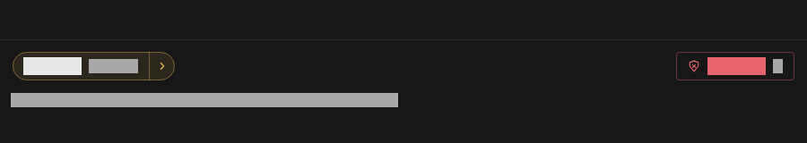

## Motion

Motion explains a state change; it does not decorate. Entries use `enter`
(`cubic-bezier(0.2, 0, 0, 1)`), exits use `exit` (`cubic-bezier(0.4, 0, 1, 1)`).
Under reduced motion distances drop to zero and loops stop, but the durations
that confirm a decision (fade, press fill, rail sweep) stay
([docs/UX.md, section 2.10](UX.md#210-reduced-motion)).

| # | Micro-interaction | Duration | Easing | What moves |
|---|---|---|---|---|
| 1 | Arrival | 180 ms (`arrive`), rows of one burst 30 ms apart, at most 5 staggered | `enter` | The row slides 8 px down into place and fades in |
| 2 | Countdown | Breath period 1200 ms (`breathe`), 3 breaths at 20 % and again at 5 % remaining | ease in-out | The ring around the glyph shrinks; the glyph breathes, never below 72 % opacity, never turning red |
| 3 | Decision | Fill 120 ms (`press`), rail sweep 200 ms (`sweep`) | `enter` | The pressed control fills, then the state rail sweeps to the new state colour |
| 4 | Leave | 220 ms (`leave`) | `exit` | Glide and fade in the first 60 %, height collapse in the last 60 %; allowed rows glide right, blocked and timed-out rows glide left, 12 px |
| 5 | Rule draw-in | 240 ms (`ruleDraw`) | `enter` | A new rule row grows and fades into the rule list, once |

Holding has its own timings: 400 ms (`holdToConfirm`) on the release valve,
250 ms (`holdToBlock`) for Block in a row and in the action bar. The three
isolation checks appear 120 ms apart (`checkStagger`), so three proofs read as
three, not as one switch. What never animates (focus rings, context menus,
row heights) is listed in [docs/UX.md, section 2](UX.md#2-the-motion-language).

## Signature elements

### Release Valve

Allow is a split pill (`HPill`, used by the intercept action bar). The left
half says "Allow" and sends the request once. The right half, a chevron, opens
the duration by target grid. Holding the left half for 400 ms fills it green
and sends the request with the remembered rule; the label switches to the
remembered action while held. Allowing cannot be undone, so the protection is
in time, not in a modal or a smaller target. Enter or Space held does the same
from the keyboard; a key repeat never decides.

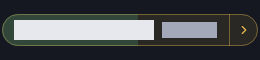

### Isolation Ring

A 20 px ring in the header bar, one arc per guarantee of the sandbox (no
network interface, exactly one socket to Humanitl, no new sockets under
seccomp). Each arc is grey while unmeasured or disconnected, yellow and
breathing while it is being measured, green when the guarantee holds and red
when it does not. A closed green ring is only ever three measured results.
The ring is a ghost button: a click opens the Sandbox section on its isolation
tab, which lists each guarantee with the evidence the shim wrote, opens the
exact sandbox command line, and adds a fourth line in the warning colour for
the declared exception, for example "Exception: LLM at 192.168.1.20:11434,
passthrough, logged, not held".

Ring states, left to right: 3 of 3 passed, 2 of 3 with one failed, no report
(all failed), not yet measured.

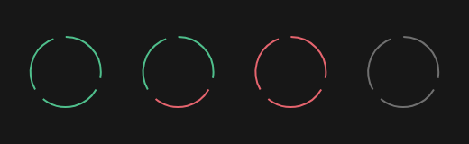

The isolation tab with three passed guarantees and the exception line:

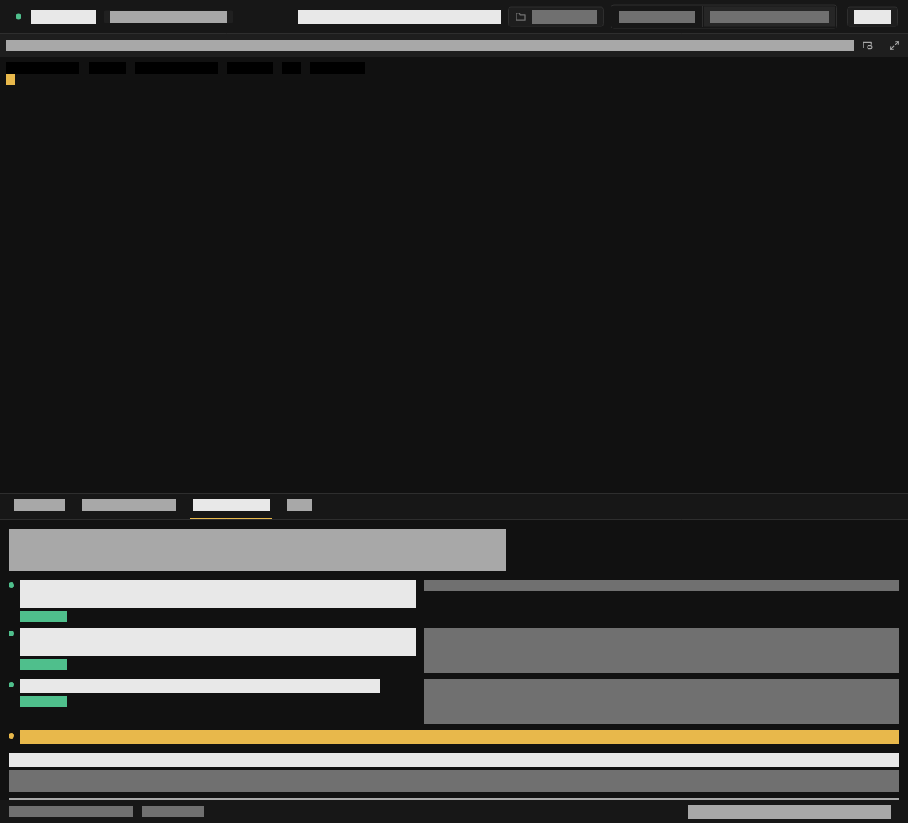

### Diff-Glow

In the request editor, every span a person replaced with a pseudonym gets a
1 px accent underline and a 10 percent accent fill
(`HEditorDecorations.glowAlpha`, `underlineWidth`). This is the one place
where the accent means something other than focus. Findings are drawn
differently, with a wavy underline: orange for checksum-verified secrets,
yellow for personal data, so "look here" and "done" differ without colour.
Which pseudonym replaced what is listed in the mapping strip below the editor,
collapsed until opened, with the original value masked; the mapping stays on
the host and never reaches the agent. BACKLOG.md section 5 sketched a hover
that shows original and pseudonym side by side; 0.1 has no such hover.

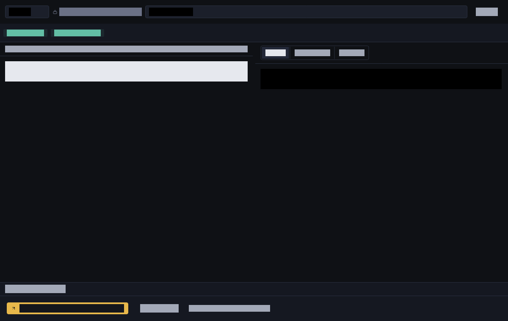

## Language

English is the source language, German is first-class from day one. Every UI
string goes through ARB files: [`app/l10n/app_en.arb`](../app/l10n/app_en.arb)
is the source, [`app/l10n/app_de.arb`](../app/l10n/app_de.arb) the
translation. German addresses the user with "du". Protocol terms stay English
in both languages (GET, POST, Header, Body, Status), and so does everything
that is stored (`allow`, `block`, `ask`, `redact` in `rules.yaml` and audit
records).

Key terms (the full list is [docs/GLOSSARY.md](GLOSSARY.md#ui-terms)):

<!-- lang: de -->
| Concept | English | German | Note |
|---|---|---|---|
| Held state | Held | Angehalten | Never "abgefangen" |
| Allow button on a request | Allow | Senden | The button says what happens |
| Allow in a rule | Allow | Erlauben | Only in rules |
| Block | Block | Blockieren | Never "Ablehnen" |
| Remember | Remember | Merken | |
| Duration (of a rule) | Duration | Gültigkeit | |
| Target (scope of a rule) | Target | Ziel | |
| This session | This session | Diese Session | "Session" stays |
| Forever | Always | Immer | |
| Redact / pseudonymize | Pseudonymize | Pseudonymisieren | Never "Anonymisieren", which is legally different |
| Finding | Finding | Fund | Never "Treffer" |
| Timed out | Timed out | Zeit abgelaufen | |
| LLM passthrough | LLM passthrough | LLM-Durchleitung | |
| Queue | Queue | Warteschlange | |
| History | History | Verlauf | |
<!-- /lang -->

## Anti-patterns

1. **Red as ambience.** Red means blocked. Errors and secrets are orange,
   warnings yellow.
2. **Modals for decisions.** Decisions happen in the queue; modals are for
   destructive confirmations only.
3. **Toast spam.** Confirmation is inline and attached to what changed.
4. **Hit targets under 28 px.** `hitMin` is the floor; decisions get 120 x 32.
5. **Stacked shadows.** Depth comes from the surface ladder and hairlines.
6. **Truncating hosts at the end.** The end of a host is the part that
   matters (`registry.npmjs.org.example.com`); paths are shortened in the
   middle, hosts not at all.
7. **Automatic favicon loading.** It would be a network request the agent did
   not make and the user did not approve.
8. **Dashboard gradients.** Flat surfaces only; colour is reserved for state.
