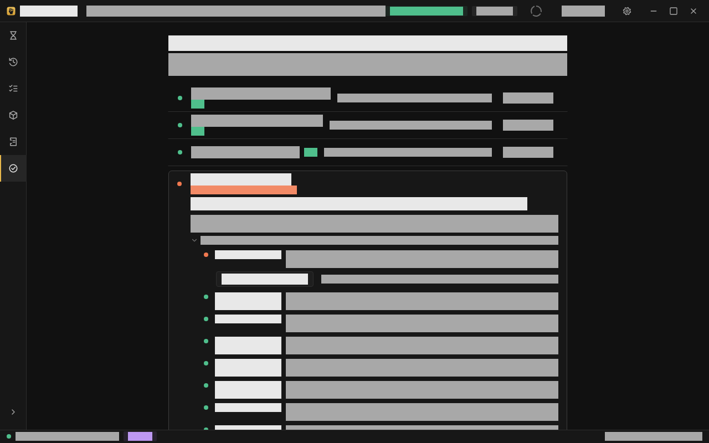
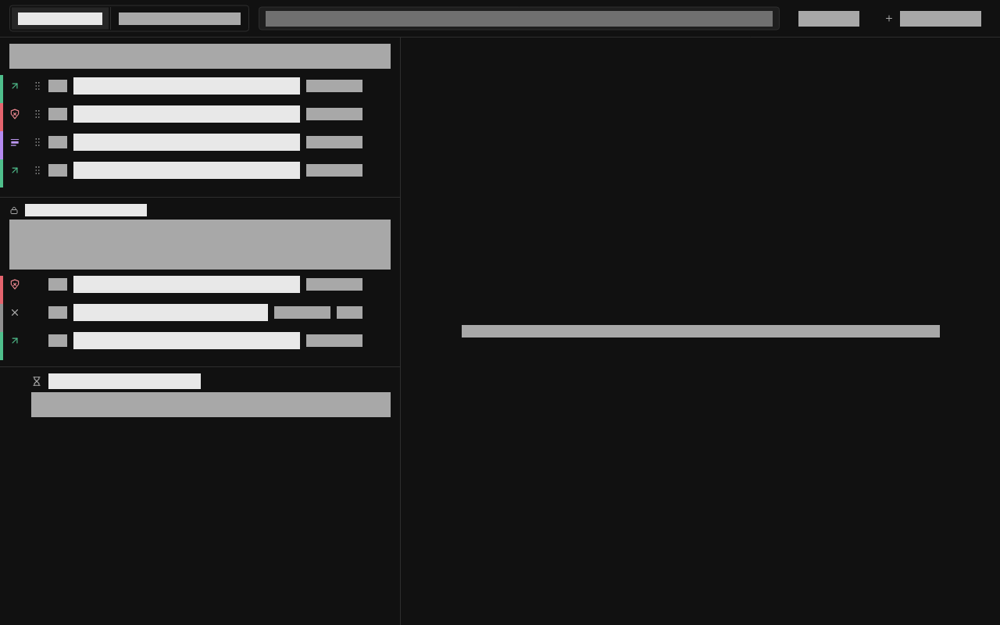
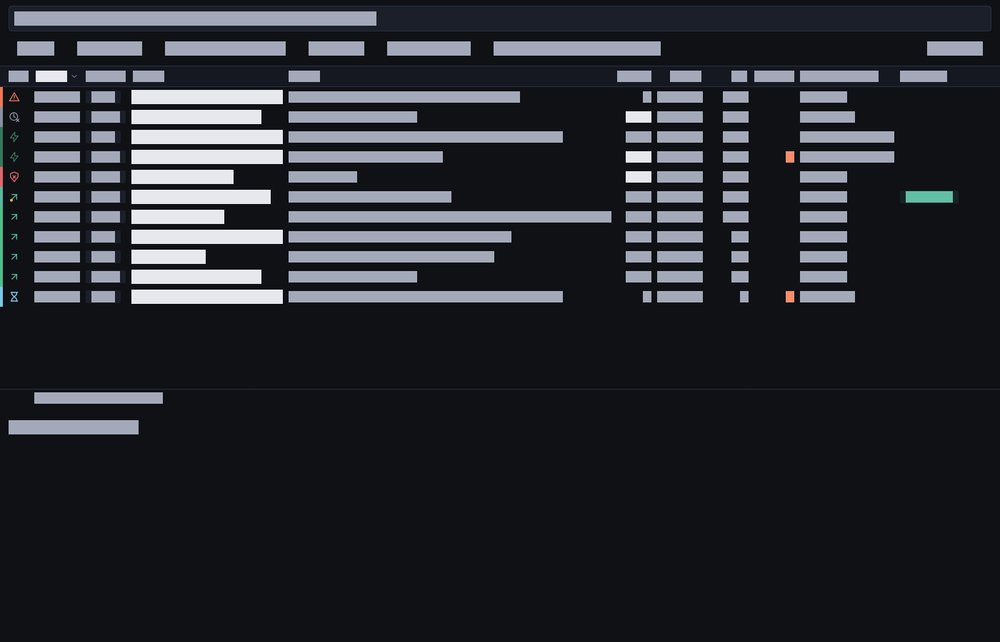

# Your first session

Applies to: Humanitl 0.1

This guide walks through a first session in the desktop app, from the setup
screen to a verified audit chain. It assumes a finished
[installation](install.md): the daemon answers `humanitl daemon status`,
`humanitl sandbox check` shows three `✓`, and OpenCode is installed where the
sandbox finds it. You also need a model server with an OpenAI-compatible API in
your network, such as Ollama, llama.cpp or vLLM.

The example project is a folder `~/demo-project`, the model server is
`http://192.168.1.50:11434`, and the agent will want to reach
`registry.npmjs.org` and `example.com`. Every step has a command-line
equivalent at the end, in [Without the app](#without-the-app).

The screenshots come from the app's golden tests, so all text in them is drawn
as grey blocks. They show the layout, not the words; the words are quoted in the
text.

## 1. Open the setup screen

Start the app from the menu ("Humanitl") or with `humanitl-app`. On a first
start it opens the setup screen; later it is the last entry of the sidebar,
"Setup" (`Ctrl+6`).



"Four things have to hold before an agent runs." Each row is the daemon's answer
about this machine:

| Row | Turns green when |
|---|---|
| Background service | the daemon answers. Without it, the row offers "Install and start". |
| Your model server | the endpoint was contacted and answered. |
| Project folder | a folder is chosen and the daemon agrees to mount it. |
| Sandbox check | every precondition of the sandbox holds: bubblewrap, user namespaces, seccomp, runtime directory. |

A row shows "ok", "worth knowing", "not measured" or "blocks the start". A row
that is not "ok" carries a card with the reason and, where there is one, a
button for the fix, such as "Copy command". The button "Start a session" at the
bottom stays off until all four rows are green, and the line under it names the
row in the way. The fourth row has "Check again" and lists the doctor's lines
about this machine; they are the same lines `humanitl doctor` prints.

## 2. Test the model server

When a model server is already saved in the configuration, Setup contacts it
once by itself when it opens, with the stored access key, and again on "Check
again" or after the saved address changes. It contacts nothing else, and
nothing at all while no address is saved. Otherwise type the address into
"Address of the model server" and press "Contact it" (or `Enter`). Typing
alone contacts nothing; the model server is the one address that traffic
reaches without passing the queue, so it is only contacted when you ask. The row then says, for example,
"http://192.168.1.50:11434 answered with 3 models in 40 ms" and lists the
models.

Do not know the address? "Find one" searches the local `/24` for model servers
on the ports 11434, 1234, 8000 and 8080, sends connection attempts and nothing
else, and offers "Use" next to each server that answered. Ollama listens on
localhost only unless `OLLAMA_HOST=0.0.0.0` is set.

Contacting the server does not save it. Open the settings with `Ctrl+,`
("Settings"), group "Model":

1. "Endpoint": the same address. It is written to `config.toml` when the field
   loses focus or on `Enter`; "Check" contacts it again.
2. "Model": the model the agent should use, for example `qwen2.5-coder:14b`.
   After a check, a click on a listed model fills it in.
3. "Access key": only if the server asks for one. It goes into the system
   keyring and never into `config.toml`.

As the settings sheet says, changes are written to `config.toml` and take effect
when the daemon starts next. Restart it once, while no session is running:

```sh
systemctl --user restart humanitld.service
```

The app reconnects by itself. Back on the setup screen, contact the server once
more so that its row is green.

## 3. Choose the project

In the row "Project folder", press "Choose the project folder" and pick
`~/demo-project`. Choosing starts nothing: the app stores the folder as
`sandbox.work_dir` in your `config.toml` and asks the daemon what a start with
it would mount, and the row turns green if the daemon agrees. You choose it
once: `humanitl run` and `humanitl sandbox run` use the same folder from any
directory, and `--work DIR` picks another one for a single call.
"The agent may" switches between "read and write" (the default) and "read only".

The folder is the only thing of yours the agent sees, as `/work`. The daemon
refuses folders it will not mount, such as your home directory itself or a path
outside it (`SANDBOX_006`), and does not store them; the card under the row
then offers "Choose another folder". A few files in the project are hidden from the agent on purpose, such
as `.env` and `.git/config`; the Sandbox screen lists them under "Mounts".

## 4. Start

With four green rows, press "Start agent". The daemon builds the sandbox,
starts OpenCode inside it, measures the three isolation guarantees, and the app
switches to "Intercept" (`Ctrl+1`). If the start fails, the app stays on the
setup screen and the row carries the finding, so you see why.

The header now shows "Intercept ON", the number of held requests, and in the
status bar "3/3 isolation checks passed".

## 5. Read the isolation check

Open "Sandbox" (`Ctrl+4`). The upper, larger half is the agent's terminal; this
is where you talk to OpenCode. The lower half has four tabs: "Mounts",
"Environment", "Isolation" and "Log". Open "Isolation".


"Each line below was measured inside the running sandbox, not on this machine,
and carries the evidence it produced."

| Line | What it proves |
|---|---|
| "No network interface. There is nowhere for traffic to go." | The sandbox has only a loopback device; there is no route out. |
| "Exactly one door: a socket that leads to Humanitl." | The only socket the agent can reach is the proxy socket. |
| "The kernel opens no new door (seccomp)." | The seccomp filter lets the agent open only TCP stream sockets, which without a network interface reach nothing but the proxy bridge on loopback. |

Each line must say "proven". "does not hold" stops the session; "not measured"
is not a pass either. Below, the panel names the one declared exception, the
model server: "Exception: LLM at http://192.168.1.50:11434 -- passthrough,
logged, never held." "Attempts past the one door" counts what the agent tried
outside HTTP and the filter refused. "Show the exact sandbox command" opens the
complete bubblewrap command line that every table on this screen is read from.

What the three guarantees mean, and what they do not cover, is in
[SECURITY.md](../SECURITY.md) and [THREAT-MODEL.md](../THREAT-MODEL.md).

## 6. Decide the first held request

Give OpenCode a task in its terminal, for example "Fetch https://example.com and
summarise it". OpenCode does not ask in its own interface before it fetches a page or
runs a command; for these, Humanitl is the one place that asks (HUM-308). The request leaves the agent, reaches Humanitl and is
held. Very often the first held
request comes even earlier: OpenCode installs its provider package from
`registry.npmjs.org` on first use, and a bundled rule holds that request so you
see it.

A held request appears in "Intercept", and a desktop notification appears if
the window is not in front.


The left column is the queue, the middle the request card, the right the domain
panel. The card says why the request was held: "Held: no rule matches ·
default: ask", or "Held: rule … says ask" for a bundled ask rule. Above it, a
countdown: when it runs out, the request is blocked and the agent receives
`504` (`hold.timeout_secs`, 300 seconds by default). The first time, a hint
explains the screen: "This request is waiting for you".

| Action | Key | Effect |
|---|---|---|
| "Allow" | `Enter` or `A` | sends the request unchanged; the response is recorded, not held |
| "Block" | `B` | the agent receives `403` and may retry |
| Note | `N` | a note for the agent; "Block with note" sends it in the block body |
| "Edit + Allow" | `E` | opens the editor (step 8) |
| next and previous request | `J` and `K` | |

Allow the request. The card says "Sent to example.com · …", and the agent gets
its answer.

## 7. Create a rule

A decision you will make again belongs in a rule. There are two ways.

**From the decision.** The arrow next to "Allow" (or `R`) opens "Remember":
"How long the rule holds" ("Once", "Session", "1 h", "Forever") and "What the
rule covers" ("URL", "Host", "Domain", "Host + method"). Pick "Session" and
"Host + method" before allowing a `GET` to `registry.npmjs.org`, and every
further `GET` there is allowed without asking until the session ends.
"Forever" asks first ("Save a permanent rule for registry.npmjs.org?") and
writes the rule to `rules.yaml`. Right after saving, "Undo" removes it again.

**In the Rules screen.** Open "Rules" (`Ctrl+3`) and press "New rule"
(`Ctrl+B`).



Fill in "Action" (`allow`), "Host" (`registry.npmjs.org`), "Methods" (`GET`,
`HEAD`), "Lifetime" ("always") and a "Note". `*` in a host stands for one
label, `**` for one or more: `**.example.com` matches `example.com` and every
subdomain. While you type, "Dry run" shows how many of the last recorded
requests the rule would have matched. "Save" adds it.

The list has two tabs, "Saved" and "Temporary" (rules for this session). The
order in which rules are evaluated is written on the screen: temporary rules
first, then saved rules, then the bundled rules, "Otherwise · ask". The bundled
rules ship with Humanitl and block what OpenCode would contact on its own; you
can switch one off, or put a rule of your own above it, but not delete it. The
full rule language is in the [rules reference](../reference/rules.md).

## 8. Edit a request before it goes out

Sometimes a request is right in principle but carries something it should not,
such as a token, an e-mail address or a file path. Select it in the queue and
press `E` ("Edit + Allow").

The editor shows two halves, "As sent" and "Going out", with the tabs "Body",
"Headers" and "Query". Findings are highlighted; "Next" jumps to the next one,
and "Replace all with pseudonyms" replaces every finding with a stable
placeholder, listed under "Mapping". The method, path and headers can be
changed; the target cannot ("The target cannot be changed"), and headers that
Humanitl sets are locked. "Send edited version" sends the right half;
"Discard" goes back to the card. The history keeps both versions.

## 9. Look at the history

Open "History" (`Ctrl+2`). Every request of this and earlier sessions is
listed with its state, method, host, path, status, size, duration, findings
and "Decided by" ("manual", "rule …", "timeout", "passthrough").



The filter takes terms such as `host:registry.npmjs.org decision:block
since:1h`; the chips "Held", "Blocked", "With findings" and "Edited" set common
ones. Traffic to the model server is hidden by default ("LLM traffic hidden").
Select a row to see the request, the response and, for an edited request, the
edited version. "Export" writes the selection or the filtered requests to a
file; the file carries hosts, full paths, all headers and both bodies in clear
text.

## 10. Verify the audit chain

Open "Audit" (`Ctrl+5`) and press "Check now". The daemon checks every record
of the audit chain against its predecessor, its MAC and the anchors, and the
status turns to "Verified", with the number of records and anchors and the time
of the last anchor. "Chain broken from sequence …" names the first record that
does not fit and why.

The table below lists the records, such as decisions and rule changes, with a
filter by kind, session and time. "Export" writes them as JSONL (complete) or CSV (overview). What
the chain proves, and what it does not, is in [SECURITY.md](../SECURITY.md).

When you are done, "Stop" on the Sandbox screen ends the session; files in
`/work` stay.

## Without the app

Every step has a command. The app and the command line talk to the same daemon
and see the same queue, rules and history.

| Step | Command |
|---|---|
| Check the machine | `humanitl doctor` |
| Find a model server | `humanitl llm discover` |
| Test it | `humanitl llm test http://192.168.1.50:11434` |
| Save it | `humanitl config set llm.endpoint http://192.168.1.50:11434` |
| Choose the model | `humanitl config set llm.models '["qwen2.5-coder:14b"]'` |
| Store an access key | `humanitl llm key set` (reads the key from stdin) |
| Start in the project | `cd ~/demo-project && humanitl run` |
| Isolation check | `humanitl run` prints the three guarantees before the agent starts; `humanitl sandbox check` measures them on their own |
| Type into the running agent | `humanitl sandbox attach` (detach with `Ctrl+A d`) |
| List held requests | `humanitl flows list state:held` |
| Look at one | `humanitl flows show <id>` |
| Allow it and remember a rule | `humanitl flows decide <id> allow --remember registry.npmjs.org --remember-method GET --remember-expires session` |
| Block it with a note | `humanitl flows decide <id> block --note "not needed"` |
| Add a rule | `humanitl rules add --action allow --host registry.npmjs.org --method GET --method HEAD --expires never --note "npm packages"` |
| Try a rule first | `humanitl rules dry-run --action allow --host registry.npmjs.org` |
| Ask what the rules say about a URL | `humanitl rules test https://registry.npmjs.org/left-pad` (exit 0 allow, 10 block, 11 ask) |
| History | `humanitl flows list host:registry.npmjs.org` |
| History with the traffic to the model | `humanitl flows list --passthrough` |
| Verify the audit chain | `humanitl audit verify` |

Editing a request before it goes out is only possible in the app.

`humanitl run` holds requests for the app by default (`--ask ui`). OpenCode is
a full-screen program, so `--ask terminal` is refused for it (`CLI_002`);
decide from a second terminal with `humanitl flows decide`, or use
`humanitl run --profile llm-only`, which lets only the model through and blocks
everything else without asking. All commands are described in the
[CLI reference](../reference/cli.md), every finding code in
[DIAGNOSTICS.md](../DIAGNOSTICS.md), and the request and body limits in
[limits](../reference/limits.md).
